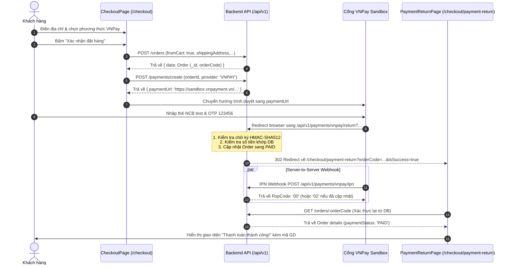

# 🛍️ Frontend E-Commerce Shop (React + TypeScript + Vite)

Giao diện người dùng cho hệ thống thương mại điện tử mua sắm trực tuyến, được xây dựng hiện đại với **React 19**, **TypeScript**, **Vite**, **TailwindCSS**, **TanStack Query (React Query)**, **Zustand** và **React Router v7**.

Giao diện phong cách Shopee hiện đại, tối ưu trải nghiệm người dùng (UX) và tích hợp hoàn chỉnh hệ thống **Đặt hàng (Order)** cùng **Cổng thanh toán trực tuyến VNPay Sandbox & COD**.

---

## 📑 Mục lục

- [1. Công nghệ & Thư viện cốt lõi](#1-công-nghệ--thư-viện-cốt-lõi)
- [2. Cấu trúc thư mục](#2-cấu-trúc-thư-mục)
- [3. Cấu hình biến môi trường (.env)](#3-cấu-hình-biến-môi-trường-env)
- [4. Chi tiết Module Đặt hàng (Order)](#4-chi-tiết-module-đặt-hàng-order)
  - [4.1. Trang Checkout (/checkout)](#41-trang-checkout-checkout)
  - [4.2. Trang Chi tiết Đơn hàng (/orders/:id)](#42-trang-chi-tiết-đơn-hàng-ordersid)
  - [4.3. Trang Danh sách Đơn hàng (/orders)](#43-trang-danh-sách-đơn-hàng-orders)
- [5. Chi tiết Module Thanh toán (Payment & VNPay)](#5-chi-tiết-module-thanh-toán-payment--vnpay)
  - [5.1. Phương thức COD (Thanh toán khi nhận hàng)](#51-phương-thức-cod-thanh-toán-khi-nhận-hàng)
  - [5.2. Cổng thanh toán VNPay Sandbox](#52-cổng-thanh-toán-vnpay-sandbox)
  - [5.3. Hộp thông tin thẻ Test Sandbox 1-chạm](#53-hộp-thông-tin-thẻ-test-sandbox-1-chạm)
  - [5.4. Trang kết quả thanh toán (/checkout/payment-return)](#54-trang-kết-quả-thanh-toán-checkoutpayment-return)
- [6. Luồng hoạt động (Sequence Diagram)](#6-luồng-hoạt-động-sequence-diagram)
- [7. Cấu hình triển khai Vercel (vercel.json)](#7-cấu-hình-triển-khai-vercel-verceljson)
- [8. Hướng dẫn khởi chạy Local](#8-hướng-dẫn-khởi-chạy-local)

---

## 1. Công nghệ & Thư viện cốt lõi

| Công nghệ | Phiên bản | Vai trò / Mục đích |
| :--- | :--- | :--- |
| **React** | 19.x | Thư viện UI xây dựng Single Page Application (SPA) |
| **TypeScript** | 5.x | Đảm bảo tính toàn vẹn kiểu dữ liệu tĩnh cho Order, Payment, Cart |
| **Vite** | 8.x | Build tool tốc độ cao, hỗ trợ Hot Module Replacement (HMR) |
| **TailwindCSS** | 4.x | Utility-first CSS framework cho giao diện responsive chuẩn Shopee |
| **TanStack Query** | 5.x | Quản lý Server State, caching giỏ hàng, tự động invalidate cache sau đặt hàng |
| **Zustand** | 5.x | Quản lý Client State cho xác thực (Access Token, thông tin User) |
| **Axios** | 1.x | HTTP Client với Request/Response Interceptor xử lý Bearer Token và `x-guest-id` |
| **Lucide React** | 1.x | Bộ icon SVG hiện đại, trực quan |

---

## 2. Cấu trúc thư mục

```
frontend/
├── src/
│   ├── components/
│   │   ├── api/
│   │   │   ├── order/order-service.ts       # API Service: createOrder, getOrders, getOrderById, cancelOrder
│   │   │   └── payment/payment-service.ts   # API Service: createPayment, getPaymentByOrderId
│   │   ├── hooks/
│   │   │   └── cart/use-cart.ts             # Custom hook TanStack Query quản lý giỏ hàng
│   │   ├── pages/
│   │   │   ├── cart/
│   │   │   │   ├── index.tsx                # Trang giỏ hàng
│   │   │   │   └── checkout.tsx             # Trang thanh toán (Order Summary, Shipping, Payment Selector)
│   │   │   ├── checkout/
│   │   │   │   └── payment-return.tsx       # Trang đón kết quả từ VNPay, xác thực DB & đối soát
│   │   │   └── order/
│   │   │       ├── index.tsx                # Trang lịch sử đơn hàng
│   │   │       └── order-detail.tsx         # Trang chi tiết đơn hàng & đồng bộ thanh toán
│   │   ├── routes/
│   │   │   ├── index.tsx                    # React Router config
│   │   │   └── protectedRoute.tsx           # Route Guard yêu cầu đăng nhập
│   │   ├── store/
│   │   │   └── auth-store.ts                # Zustand store lưu trữ accessToken & trạng thái đăng nhập
│   │   ├── types/
│   │   │   ├── order.type.ts                # TypeScript interfaces: Order, OrderItem, ShippingAddress,...
│   │   │   └── payment.type.ts              # TypeScript interfaces: PaymentRecord, CreatePaymentPayload,...
│   │   └── utils/
│   │       ├── axios-config.ts              # Cấu hình Axios withCredentials, auto refresh token, x-guest-id
│   │       └── request.ts                   # Thin wrapper unwrap response.data
│   ├── App.tsx                              # Điểm khởi chạy app, khôi phục session đăng nhập
│   └── main.tsx
├── .env                                     # Biến môi trường API Endpoint
├── vercel.json                              # Cấu hình rewrite URL cho React Router trên Vercel
└── package.json
```

---

## 3. Cấu hình biến môi trường (.env)

Tạo file `.env` tại thư mục gốc của frontend:

```env
# URL trỏ đến Backend RESTful API
VITE_API_URL=https://backend-shop-ten.vercel.app/api/v1

# Hoặc khi chạy backend local:
# VITE_API_URL=http://localhost:5000/api/v1
```

---

## 4. Chi tiết Module Đặt hàng (Order)

### 4.1. Trang Checkout (`/checkout`) - `src/components/pages/cart/checkout.tsx`
Trang đặt hàng tổng hợp toàn bộ quy trình mua sắm trước khi thanh toán:

1. **Thông tin nhận hàng (Shipping Form):**
   - Các trường bắt buộc: Họ tên, Số điện thoại, Địa chỉ chi tiết, Tỉnh/Thành phố, Email.
   - Trường tùy chọn: Mã bưu điện, Ghi chú cho người giao hàng.
   - **Tự động điền (Autofill):** Tự động điền Tên & Email từ tài khoản đăng nhập hoặc từ `localStorage` (`checkout_shipping_address`) của lần mua trước.

2. **Order Summary (Tóm tắt đơn hàng):**
   - **Hiển thị đầy đủ sản phẩm:** Liệt kê toàn bộ các sản phẩm đã chọn trong giỏ hàng (kèm ảnh, phân loại Màu/Size, SKU, số lượng, đơn giá).
   - **Cuộn mượt mà (Scrollable):** Khi có nhiều hơn 3 sản phẩm, danh sách sản phẩm kích hoạt thanh cuộn với custom scrollbar tinh tế, không làm vỡ bố cục trang.
   - **Điều chỉnh số lượng trực tiếp:** Khách hàng có thể tăng/giảm số lượng sản phẩm ngay tại tóm tắt đơn hàng với mutation tự động kiểm tra tồn kho tối đa.
   - **Thanh toán minh bạch:** Tự động tính Tạm tính (Subtotal), Phí vận chuyển (Freeship nếu tổng tiền >= 500.000đ, hoặc 30.000đ), Giảm giá voucher, và Tổng thanh toán cuối cùng.

3. **Xử lý Submit đơn hàng:**
   - Client validation kiểm tra toàn bộ trường bắt buộc.
   - Gọi `orderService.createOrder()` gửi `fromCart: true`, `shippingAddress`, `paymentMethod`.
   - Sau khi tạo đơn thành công, tự động xóa cache giỏ hàng (`queryClient.invalidateQueries(cartKeys.all)`).
   - Phân nhánh:
     - Nếu chọn **COD**: `navigate('/orders/' + order._id)` chuyển ngay đến trang chi tiết đơn hàng.
     - Nếu chọn **VNPAY**: Gọi tiếp `paymentService.createPayment()` lấy `paymentUrl` và chuyển hướng trình duyệt sang cổng thanh toán VNPay.

### 4.2. Trang Chi tiết Đơn hàng (`/orders/:id`) - `src/components/pages/order/order-detail.tsx`
- **Thông tin toàn diện:** Hiển thị mã đơn (`orderCode`), ngày đặt, trạng thái đơn hàng (`PENDING`, `CONFIRMED`, `SHIPPING`,...), danh sách sản phẩm, bảng phân rã giá và địa chỉ nhận hàng.
- **Nút "Đồng bộ trạng thái thanh toán":** Khi người dùng thanh toán qua app ngân hàng hoặc tab khác, nhấn nút này sẽ tải lại dữ liệu mới nhất từ server mà không cần F5 toàn trang.
- **Nút "Thanh toán ngay bằng VNPay":** Nếu đơn hàng chọn VNPay nhưng chưa thanh toán (`paymentStatus === 'PENDING'`), hiển thị nút cho phép tiếp tục tạo phiên thanh toán mới.
- **Khối đối soát VNPay Sandbox:** Hiển thị Mã GD VNPay (`vnp_TransactionNo`), Mã GD ngân hàng (`vnp_BankTranNo`), và Tên ngân hàng thanh toán (`vnp_BankCode`).

### 4.3. Trang Danh sách Đơn hàng (`/orders`) - `src/components/pages/order/index.tsx`
- Liệt kê toàn bộ lịch sử đơn hàng của người dùng.
- Hiển thị huy hiệu trạng thái rõ ràng: *Đã thanh toán (Xanh)*, *Chờ thanh toán (Vàng)*, *Đã huỷ (Đỏ)*.
- Hỗ trợ làm mới danh sách và xem chi tiết từng đơn.

---

## 5. Chi tiết Module Thanh toán (Payment & VNPay)

### 5.1. Phương thức COD (Thanh toán khi nhận hàng)
- Khách hàng không cần thẻ hay tài khoản ngân hàng.
- Đơn hàng được tạo ở trạng thái `orderStatus: 'PENDING'` và `paymentStatus: 'PENDING'`.
- Khi shipper giao hàng thành công (`DELIVERED`), hệ thống backend tự động chuyển `paymentStatus` sang `PAID`.

### 5.2. Cổng thanh toán VNPay Sandbox
- Tích hợp chuẩn **VNPay Gateway v2.1.0**.
- Hỗ trợ tất cả các phương thức thanh toán giả lập:
  - Quét mã VNPAY-QR
  - Thẻ ATM nội địa (NCB, Vietcombank, Techcombank,...)
  - Thẻ quốc tế (Visa, MasterCard, JCB)

### 5.3. Hộp thông tin thẻ Test Sandbox 1-chạm
Ngay trên trang Checkout, giao diện tích hợp widget hiển thị thông tin thẻ test NCB Sandbox chính thức từ VNPay kèm nút **Copy 1-chạm** tiện lợi:

| Thông tin | Giá trị Test | Thao tác |
| :--- | :--- | :--- |
| **Ngân hàng** | `NCB` | Chọn ngân hàng NCB trên cổng VNPay |
| **Số thẻ** | `9704198526191432198` | Nút Sao chép (Copy to clipboard) |
| **Tên chủ thẻ** | `NGUYEN VAN A` | Nút Sao chép (Copy to clipboard) |
| **Ngày phát hành** | `07/15` | Nhập vào ô Tháng/Năm |
| **Mã OTP** | `123456` | Nút Sao chép (Copy to clipboard) |

### 5.4. Trang kết quả thanh toán (`/checkout/payment-return`) - `src/components/pages/checkout/payment-return.tsx`

Sau khi thanh toán xong trên VNPay, khách hàng được điều hướng về trang này:

1. **Xác thực 2 lớp an toàn tuyệt đối:**
   - **Lớp 1 (URL parameters):** Tiếp nhận `orderCode`, `isSuccess`, `transactionId` từ backend chuyển hướng về.
   - **Lớp 2 (Database verification):** Không tin tưởng hoàn toàn dữ liệu URL, component tự động gọi `orderService.getOrderById(orderCode)` và `paymentService.getPaymentByOrderId(orderId)` để lấy dữ liệu thực tế đã lưu trong MongoDB.
2. **Hiển thị trực quan:**
   - **Thành công:** Banner xanh lá với mã giao dịch VNPay, mã GD ngân hàng, ngân hàng thanh toán, thời gian ghi nhận và nút "Xem chi tiết đơn hàng" / "Tiếp tục mua sắm".
   - **Thất bại / Hủy bỏ:** Banner đỏ với lý do thất bại (ví dụ: người dùng hủy giao dịch) và nút **"Thanh toán lại qua VNPay"** để tạo ngay liên kết thanh toán mới.
3. **Thông tin đối soát Sandbox:**
   - Hiển thị đầy đủ `vnp_TxnRef` và `vnp_TransactionNo` để đối soát chéo trên trang quản trị VNPay Merchant Sandbox.

---

## 6. Luồng hoạt động (Sequence Diagram)



---

## 7. Cấu hình triển khai Vercel (`vercel.json`)

Do Frontend là ứng dụng **React Single Page Application (SPA)** dùng React Router, khi người dùng F5 hoặc được VNPay redirect về một đường dẫn sâu như `/checkout/payment-return`, Vercel cần biết phải chuyển hướng về `index.html`.

File [`vercel.json`](file:///d:/frontend/vercel.json) tại thư mục gốc:

```json
{
  "rewrites": [
    {
      "source": "/(.*)",
      "destination": "/index.html"
    }
  ]
}
```

---

## 8. Hướng dẫn khởi chạy Local

### Yêu cầu môi trường
- Node.js >= 18.x
- npm hoặc yarn

### Các bước cài đặt

```bash
# 1. Cài đặt dependencies
npm install

# 2. Khởi chạy môi trường phát triển (Dev Server)
npm run dev
```

Mở trình duyệt tại địa chỉ: `http://localhost:3000` (hoặc port được hiển thị trên terminal).

### Kiểm tra kiểu dữ liệu & Build production

```bash
# Kiểm tra TypeScript
npx tsc -b

# Build phiên bản Production
npm run build
```
